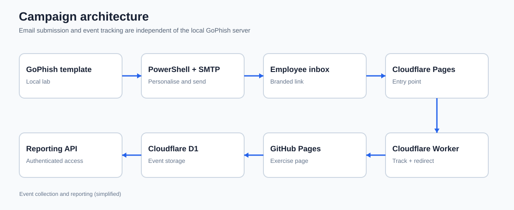

# CyberLab 002: Employee phishing-awareness simulation

**An authorised workplace simulation combining personalised emails, cloud-hosted interaction tracking and campaign reporting.**



**Status:** Deployed; engagement monitoring in progress  
**Scope:** 34 enrolled participants  
**Focus:** Security awareness, Linux administration, SMTP, PowerShell automation, event logging and reporting

## What I implemented

- Installed and configured GoPhish on an Ubuntu Server VM, with access through SSH port forwarding.
- Built a Cloudflare Worker and D1-backed workflow to record clicks, page visits and submission attempts.
- Configured a branded Cloudflare Pages entry point and a GitHub Pages landing page.
- Validated 34 unique recipient addresses and tracking links, matching each link by employee ID.
- Used PowerShell to personalise the existing HTML template, test SMTP delivery and log campaign submissions.
- Verified end-to-end tracking in an external mailbox and preserved a baseline to separate test activity from later engagement.

## Why I built it

I wanted to understand what it takes to run a phishing-awareness exercise beyond designing a convincing email. A useful simulation also needs dependable links, a way to attribute interactions to the right participants, and reporting that separates real engagement from testing artefacts.

I began with GoPhish on an Ubuntu Server virtual machine. The first practical obstacle was networking: the server was reachable inside my VirtualBox lab, but its links were not accessible to recipients outside that network. Rather than expose the VM to the public internet, I moved the tracking and landing-page components to hosted services and kept GoPhish for template development.

The finished workflow uses PowerShell and authenticated Gmail SMTP to submit personalised emails, Cloudflare to record events, and GitHub Pages to host the exercise page. The hosted tracking components remain available when my local lab is switched off.

## Architecture

The diagram above shows the deployed flow. The important distinction is that **GoPhish is not the live tracking backend** for this campaign.

1. I prepared the recipient list and checked for duplicate addresses.
2. Each participant received a unique token linked to an internal employee ID.
3. PowerShell inserted the first name and branded link into the GoPhish HTML template, then submitted emails through Gmail SMTP.
4. The branded Cloudflare Pages entry point forwarded requests to a Cloudflare Worker, which logged link clicks and redirected visitors to the GitHub Pages exercise page.
5. The landing page reported page visits and submission attempts to the Worker. The system recorded events, not sensitive form contents.
6. Cloudflare D1 stored the records, and an authenticated reporting endpoint returned campaign-level participant metrics.

## Tools and responsibilities

| Tool | Role |
| --- | --- |
| Ubuntu Server / VirtualBox | Isolated GoPhish lab |
| GoPhish | Email template development and initial testing |
| PowerShell | Recipient validation, template personalisation, SMTP submission and report retrieval |
| Gmail SMTP | Authenticated email submission |
| Cloudflare Pages | Branded link entry point |
| Cloudflare Workers | Redirect handling, event collection and reporting API |
| Cloudflare D1 | Campaign, participant and event storage |
| GitHub Pages | Exercise landing page |

## Implementation decisions

### Keep the local lab private

The initial GoPhish links pointed to a private VirtualBox address. Those links worked in the lab but were unsuitable for external recipients. Hosting the tracking flow separately solved the accessibility problem without opening the VM to the internet.

### Match participants by ID, not CSV position

The email list and tracking export came from separate processes. I checked that all 34 expected participant IDs were present and unique, then used those IDs to associate each recipient with the correct tracking link. This was safer than relying on row order alone.

### Test the complete journey before launch

I checked the HTML in an external Outlook mailbox, followed the branded link through the redirect, and confirmed that Cloudflare recorded the test click and landing-page visit. I also checked for missing links and unresolved template placeholders before sending.

### Preserve a baseline

During setup, I opened a link belonging to one enrolled participant. That test appeared in the reporting data. I saved a baseline rather than deleting the event, so later analysis can distinguish setup activity from subsequent engagement. That participant remains eligible for genuine post-launch tracking.

## Validation and deployment

| Check | Observed result |
| --- | ---: |
| Enrolled employee records | 34 |
| Valid, unique recipient addresses | 34 |
| Unique branded links | 34 |
| Missing participant IDs or duplicate IDs | 0 |
| Unresolved email placeholders | 0 |
| External HTML email test | Passed |
| Branded redirect and click tracking test | Passed |
| SMTP submissions accepted | 34 |

**What these results mean:** The SMTP server accepted 34 submissions. This is not proof that all 34 messages reached an inbox or were read. At the first report check, the only recorded employee-associated click and page visit matched a link used during setup, so I did not count it as confirmed post-launch engagement.

## What I learnt

- **Network boundaries matter.** A service working in a lab does not mean it is reachable from the internet.
- **Integration creates its own risks.** Tracking tokens, recipient records and email templates must stay correctly associated across systems.
- **Delivery has stages.** SMTP acceptance, inbox placement, email opening and link engagement are different outcomes.
- **Measurement needs an audit trail.** Test traffic can distort campaign results if it is not identified and accounted for.
- **Availability can be decoupled.** The cloud-hosted tracking system does not depend on keeping the Ubuntu VM running.

## Security and privacy

This was an authorised workplace exercise. The landing page did not collect passwords, identification numbers or sensitive form entries. Administrative reporting used an API key.

The public repository intentionally excludes employee names and email addresses, real campaign tokens, API keys, SMTP credentials, private event exports and internal reports. Screenshots should be sanitised and publication of identifiable organisational details should be approved first.

## Repository contents

```text
CyberLab-002/
├── README.md
├── docs/
│   ├── architecture.svg
│   ├── architecture.mmd
│   ├── evaluation-plan.md
│   └── publishing-checklist.md
├── examples/
│   ├── README.md
│   └── engagement-summary.ps1
└── screenshots/
    └── README.md
```

The `examples/` directory contains a **sanitised illustrative reporting script**, not a copy of the production deployment. The actual Worker, D1 schema and email-sending code should only be added after a separate review for secrets, participant data and organisation-specific details.

## Next steps

The campaign is in its observation period. After it ends, I plan to produce an anonymised summary of link clicks, landing-page visits and submission attempts, accounting for test activity and acknowledging that a click does not necessarily indicate human engagement (for example, automated email security scanners can follow links).

I will add the final results only after checking the event data and confirming that public disclosure is permitted.
